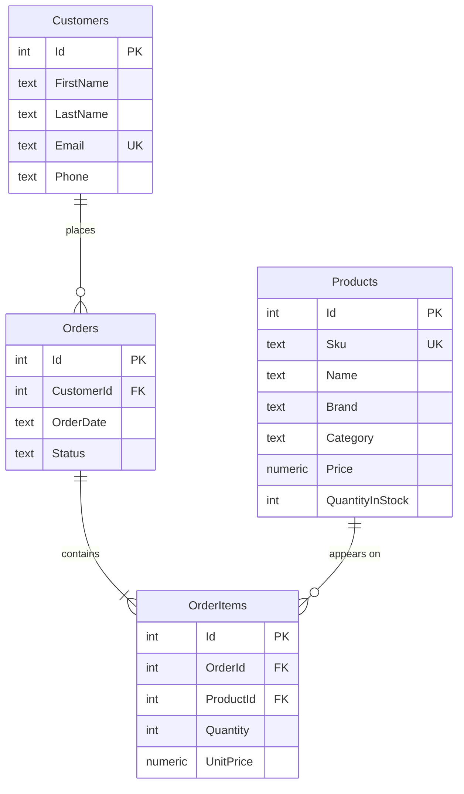

# Golf Store Manager

A console application for managing a golf shop's inventory, customers, and orders, built with **C# / .NET 11** and **SQLite**.

All create, read, update, and delete (CRUD) operations use hand-written, parameterized SQL through ADO.NET (`Microsoft.Data.Sqlite`). The app doesn't use an ORM.

## Features

- **Products & inventory:** list, search, add, edit, and delete products. Receive shipments or write off damaged stock.
- **Customers:** list, search, add, edit, and delete customers. View a customer's order history.
- **Orders:** create multi-item orders, view line-item details, move an order through *Pending → Shipped → Delivered*, cancel an order, or delete it.
- **Inventory integrity:**
  - Placing an order takes its items out of stock inside a database **transaction**. If any item is short, nothing is saved.
  - Cancelling or deleting a pending order puts its items back in stock.
  - Each order line stores the price at the time of sale, so a later price change doesn't alter past orders.
- **Reports:** a low-stock report and revenue by category.
- **Data rules enforced by the database:** foreign keys, `CHECK` constraints (for example, stock can't go below zero), and `UNIQUE` SKUs and emails.

## Database schema



The full DDL is in [`Sql/schema.sql`](Sql/schema.sql), and the sample data is in [`Sql/seed.sql`](Sql/seed.sql).

## Getting started

**Prerequisite:** [.NET 11 SDK](https://dotnet.microsoft.com/download)

```bash
git clone https://github.com/<your-username>/GolfStoreManager.git
cd GolfStoreManager
dotnet run
```

On first launch, the app creates `golfstore.db` next to the executable and loads it with sample products, customers, and orders. To start over with fresh data, delete that file.

## Project structure

```
GolfStoreManager/
├── Program.cs                  # Entry point and main menu
├── Data/
│   ├── Database.cs             # Connection factory, schema setup, seeding
│   └── SqliteExtensions.cs     # Parameterized command helpers
├── Models/                     # Product, Customer, Order records
├── Repositories/               # All SQL lives here, one class per table area
│   ├── ProductRepository.cs
│   ├── CustomerRepository.cs
│   └── OrderRepository.cs
├── UI/                         # Console menus and input helpers
└── Sql/
    ├── schema.sql
    └── seed.sql
```

## Concepts demonstrated

- ADO.NET data access with parameterized queries, which prevent SQL injection
- The repository pattern, which keeps SQL separate from the UI
- Multi-statement transactions with commit and rollback
- Aggregate queries using `JOIN`, `GROUP BY`, `SUM`, and `COALESCE`
- Referential integrity through foreign keys (`ON DELETE CASCADE` and `RESTRICT`)
- C# records, primary constructors, raw string literals, and nullable reference types
